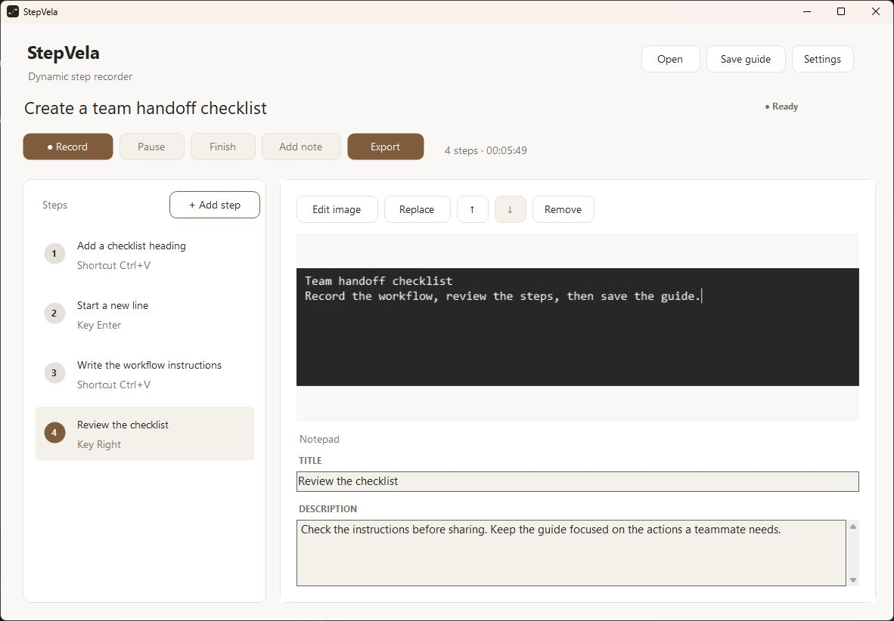
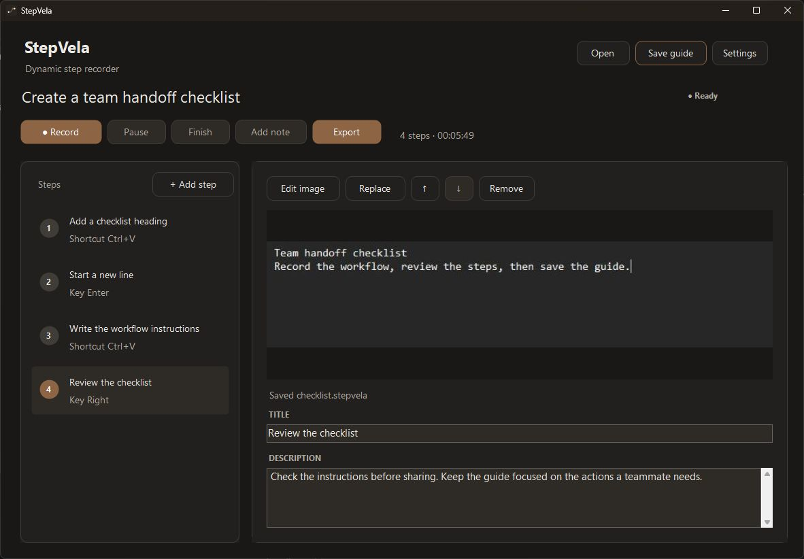
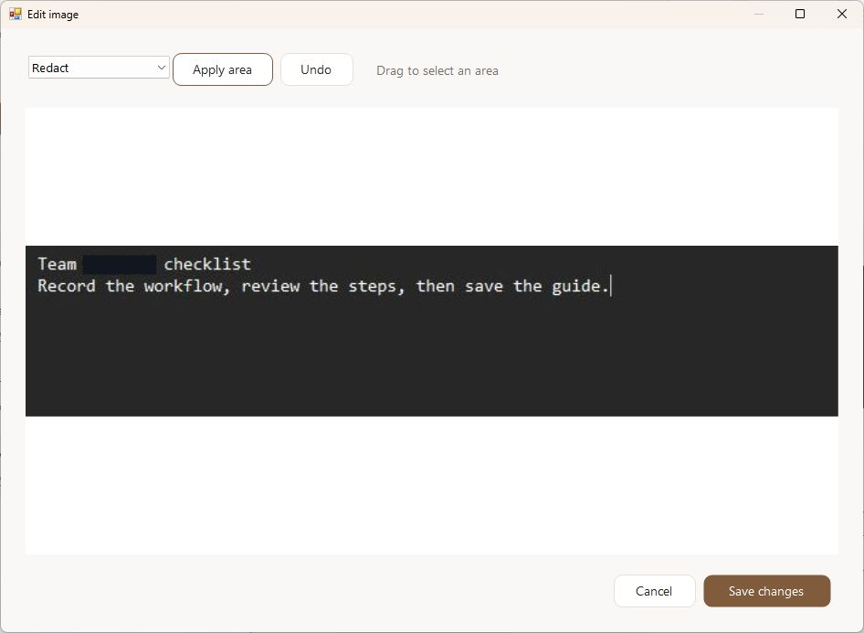

<div align="center">
  
  <h1>StepVela</h1>
  <p>Turn desktop workflows into clear, editable guides.</p>
  <p>Windows · Offline · Open source</p>
  <p>
    <a href="https://github.com/sanketshinde3001/stepvela/releases/latest/download/StepVela-Setup.msi"><strong>Download installer</strong></a>
    · <a href="https://github.com/sanketshinde3001/stepvela/releases/latest/download/StepVela-Portable.zip">Portable ZIP</a>
    · <a href="https://github.com/sanketshinde3001/stepvela/releases">Releases</a>
  </p>
</div>

## Screenshots

<table>
  <tr>
    <th>Light</th>
    <th>Dark</th>
  </tr>
  <tr>
    <td><a href="assets/workspace-light.jpg"></a></td>
    <td><a href="assets/workspace-dark.jpg"></a></td>
  </tr>
</table>

<p align="center">
  <strong>Image editor</strong><br><br>
  <a href="assets/image-editor.jpg"></a>
</p>

## Features

- **Record** clicks, scrolls, typing events, shortcuts, and screenshots. Pause and resume anytime.
- **Refine** titles and descriptions, add manual steps, reorder, and replace images.
- **Edit images** with crop, highlight, solid redaction, and Undo.
- **Share** offline HTML, Markdown, and JSON in one ZIP, or save an editable `.stepvela` guide.

Native C# app: **96 KiB executable**, about **58 MiB idle memory** on the test PC. [Measured results →](docs/VERIFICATION.md)

## Install

| Download | Use |
| --- | --- |
| [Windows installer](https://github.com/sanketshinde3001/stepvela/releases/latest/download/StepVela-Setup.msi) | Follow setup, then launch from the Start Menu. |
| [Portable ZIP](https://github.com/sanketshinde3001/stepvela/releases/latest/download/StepVela-Portable.zip) | Extract and open `StepVela.exe`. |

Requires **Windows 10/11 and .NET Framework 4.8+**. Tested on Windows 11. The initial release is **unsigned**; Windows may show a warning. [SHA-256 checksums](https://github.com/sanketshinde3001/stepvela/releases/latest/download/SHA256SUMS.txt) verify file integrity, not publisher identity.

## Quick start

1. Select **Record**, perform your workflow, then **Finish**.
2. Edit the steps and review screenshots before sharing.
3. **Save guide** keeps an editable project. **Export** creates a ZIP—extract it and open `report.html`.

Try the [recorded checklist example](examples/checklist.stepvela) with **Open**.

| Shortcut | Action |
| --- | --- |
| `Ctrl + Shift + F8` | Start / pause / resume |
| `Ctrl + Shift + F9` | Finish |

The default captures the active window and retains **25 screenshots**. Adjust capture area and retention in **Settings**. Shortcuts may conflict with other apps.

## Privacy

Everything stays local. No account, telemetry, or uploads. Printable key content is not stored as text; screenshots and window labels can still contain private information. Review and redact before sharing. [Security details →](SECURITY.md)

Elevated windows and protected content may be inaccessible. [Limits and verification →](docs/VERIFICATION.md)

## Build

Uses C#, Windows Forms, and .NET Framework. No bundled browser runtime.

```powershell
./scripts/build.ps1 -Test
./build/StepVela.exe
```

[Build and packaging](docs/BUILDING.md) · [Contributing](CONTRIBUTING.md) · [Report an issue](https://github.com/sanketshinde3001/stepvela/issues)

MIT © 2026 Sanket Rajendra Shinde. [License](LICENSE)
## Support

If StepVela helps you create clearer guides, you can [support its development](https://buymeacoffee.com/sanketshinde).
